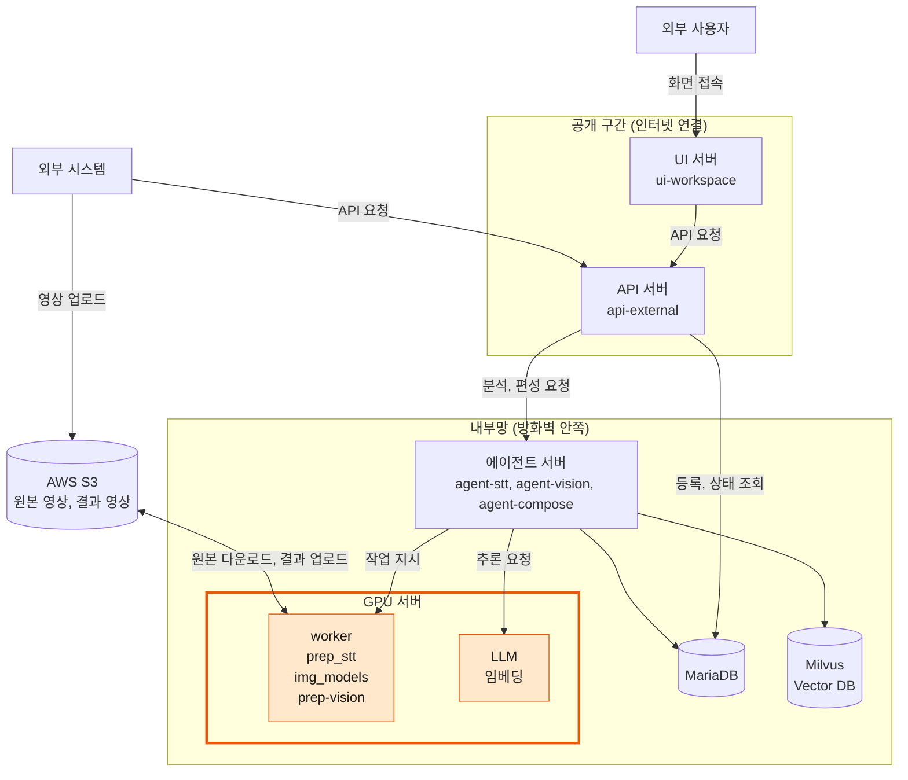
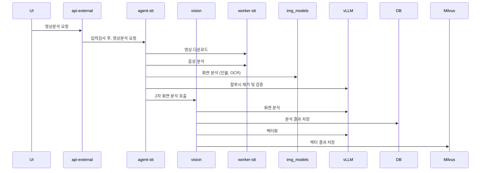
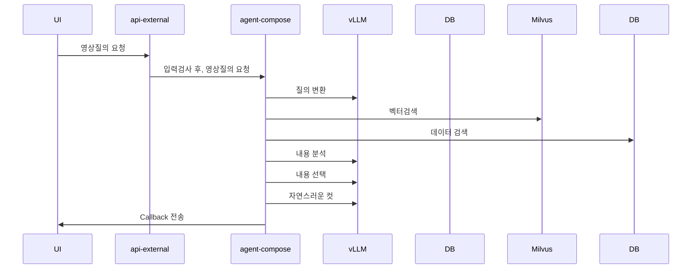

## 1. 개요

SceneMaker 는 방송 영상 1편을 받아 오픈소스 멀티모달 AI 로 분석·색인하고, 자연어 질의로 하이라이트 구간을 편성해 주는 서비스다. 시스템 전체는 두 개의 흐름으로 나뉜다.

| 흐름 | 시작 | 끝 | 하는 일 |
| --- | --- | --- | --- |
| **입력(분석) 공정** | 영상 등록 (api-external) | 색인 완료 (MariaDB + Milvus) | 음성 → 자막 → 프레임 검출 → 장면 분석 → 임베딩 색인 |
| **질의(편성) 공정** | 편성 요청 (api-external) | 클립 구간 목록 (콜백) | 질의 해석 → 증거 검색 → 장면 선택 → 경계 확정 → 분량 조정 |

두 흐름을 가르는 설계 원칙은 하나다. **오케스트레이터는 GPU 연산을 하지 않는다.** 무엇을 어떤 순서로 처리할지는 `agent-*` 가 정하고, 실제 추론은 원격 GPU 서버(워커·vLLM)가 한다. 컴포넌트끼리는 HTTP 와 공유 DB, 그리고 `status_code` 로 느슨하게 연결된다. 4대 서비스 중 현재 구현은 **모아보기(하이라이트 편성)** 에 해당한다.

---

## 2. 서비스 Flow

### 2.1 영상 분석

### 2.2 영상 질의

---

## **3. 컴포넌트**

| 층 | 컴포넌트 | 종류 | 역할 |
| --- | --- | --- | --- |
| 진입 | **api-external** | FastAPI | 외부 공개 API 게이트웨이. 그룹·영상 등록은 DB 에 직접, 분석·편성은 뒷단에 그대로 프록시, 상태는 DB 조회 |
| 오케스트레이터 | **agent-stt** | FastAPI | 1차 공정(자막). 추출 → STT → 교정 → 할루시 필터 → 요약, 프레임 검출, 화자 이름, 저장, 다음 단계 트리거 |
| 오케스트레이터 | **agent-vision** | FastAPI | 2차 공정(화면 분석). 장면 분할 → 전광판 읽기 → 장면 분류·요약 → 플레이·장면 구성 → Milvus 색인 |
| 오케스트레이터 | **agent-compose** | FastAPI + LangGraph | 질의 공정(편성). 질의 해석 → 증거 검색 → 장면 선택 → 경계 → 분량 |
| 워커 | **worker-prep_stt** | FastAPI (GPU) | S3 다운로드, ffmpeg 오디오·1fps 프레임 추출, 1차 전사(pyannote + Qwen3-ASR), 2차 전사(faster-whisper) |
| 워커 | **worker-img_models** | FastAPI (GPU) | 프레임 분류·검출. 야구 스코어보드(SigLIP2 + RF-DETR), 드라마 얼굴 군집 |
| 워커 | **worker-prep-vision** | FastAPI (CPU + VLM 호출) | PySceneDetect 장면 컷, 전광판 crop 을 VLM 으로 읽어 텍스트화 |
| 워커 | **worker-render** | FastAPI (GPU) | 구간 목록 → 범퍼 삽입 → ffmpeg 컷·concat → MP4 → S3 업로드 |
| 추론 | **vLLM** | OpenAI 호환 서버 | 텍스트 LLM(Qwen, `/v1/chat/completions` ), VLM(Qwen3-VL), 임베딩(`/v1/embeddings` ) |
| 저장소 | **MariaDB** | RDB | 등록·상태·자막·프레임·장면·편성. 모든 컴포넌트가 공유 |
| 저장소 | **Milvus** | 벡터 DB | 장면 텍스트(shot / stt / etc) 임베딩. 색인은 agent-vision, 검색은 agent-compose |
| 저장소 | **S3 / NVMe** | 파일 | 원본 영상(S3), 추출 산출물·crop·렌더 결과(워커 로컬 → S3) |
| UI | **ui-workspace** | Next.js | 업로드(S3 presigned + t_video 등록)·분석 결과 조회 콘솔 |

실제 호스트·IP 는 각 컴포넌트 `.env` 에만 둔다.

---

## **4. 데이터**

#### 4.1 MariaDB

| 묶음 | 내용 |
| --- | --- |
| 등록 | 카테고리, 그룹(콜백), 영상(회차·`stream_yn` ·`summary_stt` ), 조각(`file_path` ·`status_code` ·`idx_last` ), 코드 문구 |
| 자막 | 교정·필터를 거친 대사(시각·화자·언어·이름), 구간·전체 요약 |
| 프레임(야구) | 프레임별 분류·보드 박스·항목 7개, 영상 단위 고정 박스 |
| 화자(드라마) | 얼굴 군집 이름, 시리즈 단위 얼굴 벡터 은행 |
| 장면(야구) | 장면 컷(+분류·요약), 스코어보드 타임라인, 투구 단위 플레이, 편성용 장면(이닝·팀·점수·태그·라벨·끝 후보) |
| 편성 | 요청·상태·분량, 대상 조각, 결과 클립 |
| 보조 | 팀 별칭 |

재처리는 어느 공정이든 같은 규칙이다. **그 조각과 그 뒤 조각의 결과를 지우고 다시 만든다.**

#### 4.2 두 개의 시간축

야구는 이닝 조각으로 들어오므로 시각이 두 축으로 존재한다. 조각 안에서의 시각(`idx_stream_sec` , `*_stream_time` )과 영상 전체 기준 시각(`idx_sec` , `*_time` )이다. 전체 축의 오프셋은 앞 조각들의 `idx_last + 1` 합이다. 프레임·장면 테이블은 두 축을 다 갖고, 편성 결과(콜백)는 **조각 축** 으로 나간다. 렌더도 조각 파일 기준이다.

#### 4.3 Milvus

| 항목 | 값 |
| --- | --- |
| 컬렉션 | 야구 `sm_sport_baseball` , 드라마 `sm_drama` |
| 행 종류(`kind` ) | `shot` (장면 요약) · `stt` (대사) · `etc` (전광판 ETC 문구) |
| 스칼라 필드 | `v_id, stream_id, start_sec, end_sec, scene_stream_seq, scene_seq, shot_type, labels, board_tags, inning, home_team, away_team, score, score_delta, text` |
| 벡터 | 2560차원 (Qwen3-Embedding 계열, vLLM `/v1/embeddings` ) |
| 쓰기 / 읽기 | agent-vision PUBLISH(delete-insert) / agent-compose retrieve_evidence(필터 + top_k) |

#### 4.4 파일

| 위치 | 경로 규칙 | 만드는 곳 |
| --- | --- | --- |
| S3 원본 | `video_file.file_path`  객체 키 | 외부 업로드 |
| 워커 로컬 | `MEDIA_DIR/{v_id}/{stream_id}/{stream_id}.mp4`  · `{stream_id}_audio.wav`  · `00000.jpg …` (1fps) | worker-prep_stt |
| 워커 로컬 | `…/{stream_id}/img_models/{항목}/{idx}.jpg`  (전광판 crop) | worker-img_models |
| 렌더 | `{VOD_DIR}/{v_id}/result/{v_id}_{c_id}.mp4`  + `.json`  → S3 `result/` | worker-render |

워커들은 **파일을 전송받지 않고** `v_id/stream_id` **로 경로를 유도** 한다. 그래서 prep_stt·img_models·prep-vision·agent-vision 은 같은 저장소(NVMe)를 보는 호스트에 있어야 한다.

---

## 5. **상태 코드**

행 상황은 전부 `status_code` 숫자로 남기고, 문구는 `t_code` 테이블이 갖는다. 번대가 곧 소유 컴포넌트다.

| 번대 | 소유 | 테이블 | 주요 값 |
| --- | --- | --- | --- |
| 1000 | UI (업로드) | `t_video` | 1001 업로드 |
| 2000 | agent-stt | `t_video_file` | 2001 접수 · 2010/2011 추출 중/완료 · 2020 검색 · 2030 대사 추출 · 2040 재확인 · 2050/2060 교정 · 2070 할루시 · 2080 요약 · 2085 화자 · **2000 완료** |
| 3000 | agent-vision | `t_video_file` | 3010 PREP · 3020 BOARD · 3060 VISION · 3030 PLAY · 3040 SCENE · 3050 PUBLISH · **3000 완료**  · 3900 실패 · 3901 미지원 |
| 4000 | agent-compose | `t_compose` | 4020 PLAN · 4030 CUT · 4040 VERIFY · **4000 완료**  · 4001 빈 편성 · 4900 오류 · 4050/4950 렌더(렌더 소유) |

agent-stt 의 실패 코드는 규칙이 있다. **진행 코드 + 900 = 그 단계의 실패 코드** 이고, 끝자리가 원인을 가른다(+0 기타 / +1 연결 실패 / +2 시간 초과 / +3 단계 고유). 예를 들어 2030 대사 추출 중 전사 서버에 연결이 안 되면 2931 이다. 코드 값은 소스에 두고 DB 에서 읽지 않는다. DB 가 죽었을 때(2996)도 기록해야 하기 때문이다.

---

## 6. 설계 원칙

1. **오케스트레이터는 GPU 연산을 하지 않는다.**  추론은 OpenAI 호환(`/v1/chat/completions` ·`/v1/embeddings` ) 또는 워커 자체 HTTP 로 부르고, 원격을 갈아끼워도 스펙이 같으면 `.env`  의 주소만 바꾼다. 스펙이 바뀌면 `lib/client/*`  만 고친다.
2. **받자마자 응답, 공정은 백그라운드.**  진행은 `status_code`  로 알리고, 완료 보고는 콜백으로 한다.
3. **'완료'의 기준은 하나.**  상태 코드는 한 곳에서 찍고, 저장은 한 트랜잭션으로 한다. 반쪽 저장은 하지 않는다.
4. **카테고리 표 하나가 공정을 정한다.**  스텝 순서는 고정이고 표는 켜고 끌 것과 재료만 정한다. 새 카테고리는 표에 한 줄이다.
5. **실패 정책은 스텝 성질로 정한다.**  보조 스텝(명단 검색·2차 전사·Milvus 색인)은 삼키고, 핵심 스텝은 전체 실패로 올린다. 실패 코드는 진행 코드 + 900.
6. **워커는 모델을 상주시키고 단일 프로세스로 돈다.**  `uvicorn --workers`  는 쓰지 않는다. GPU 락으로 직렬화하고, 실패도 HTTP 200 에 `Result` /`status`  번호로 돌려준다. 거절 사유 번호는 뒤에 붙이기만 한다.
7. **재처리는 뒤까지 지운다.**  `forced_yn` /`force`  는 그 조각과 그 뒤 조각의 결과를 지우고 다시 만든다.
8. **LLM 출력은 코드가 검산한다.**  선택지를 프롬프트에 주고 어휘 밖 값은 폐기한다. 자막 교정은 text 만 바꾸고, 잘리면 원문으로 되돌린다.
9. **운영 좌표는** `.env`  **에만.**  IP·자격증명은 코드와 문서에 적지 않는다.

---

