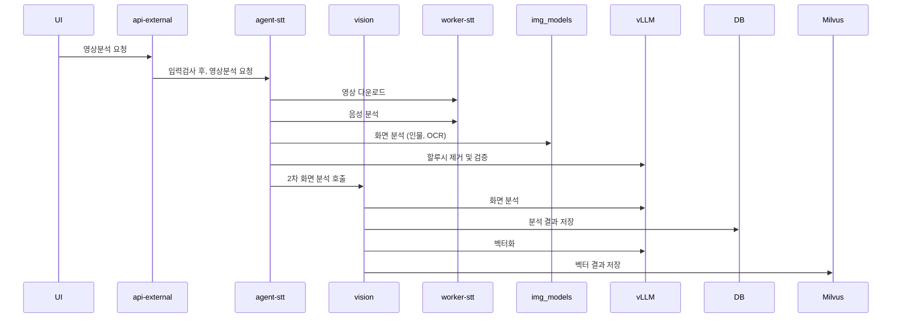
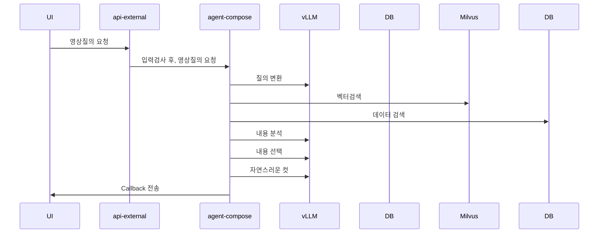

## 1. 개요

SceneMaker 는 방송 영상 1편을 받아 오픈소스 멀티모달 AI 로 분석·색인하고, 자연어 질의로 하이라이트 구간을 편성해 주는 서비스다. 시스템 전체는 두 개의 흐름으로 나뉜다.

| 흐름 | 시작 | 끝 | 하는 일 |
| --- | --- | --- | --- |
| **입력(분석) 공정** | 영상 등록 (api-external) | 색인 완료 (MariaDB + Milvus) | 음성 → 자막 → 프레임 검출 → 장면 분석 → 임베딩 색인 |
| **질의(편성) 공정** | 편성 요청 (api-external) | 클립 구간 목록 (콜백) | 질의 해석 → 증거 검색 → 장면 선택 → 경계 확정 → 분량 조정 |

두 흐름을 가르는 설계 원칙은 하나다. **오케스트레이터는 GPU 연산을 하지 않는다.** 무엇을 어떤 순서로 처리할지는 `agent-*` 가 정하고, 실제 추론은 원격 GPU 서버(워커·vLLM)가 한다. 컴포넌트끼리는 HTTP 와 공유 DB, 그리고 `status_code` 로 느슨하게 연결된다. 4대 서비스 중 현재 구현은 **모아보기(하이라이트 편성)** 에 해당한다.


---

## 2. 구성도

### 2.1 영상 분석





### 2.2 영상 질의





---

## **3. 컴포넌트**

| 층 | 컴포넌트 | 종류 | 역할 |
| --- | --- | --- | --- |
| 진입 | **api-external** | FastAPI | 외부 공개 API 게이트웨이. 그룹·영상 등록은 DB 에 직접, 분석·편성은 뒷단에 그대로 프록시, 상태는 DB 조회 |
| 오케스트레이터 | **agent-stt** | FastAPI | 1차 공정(자막). 추출 → STT → 교정 → 할루시 필터 → 요약, 프레임 검출, 화자 이름, 저장, 다음 단계 트리거 |
| 오케스트레이터 | **agent-vision** | FastAPI | 2차 공정(화면 분석). 장면 분할 → 전광판 읽기 → 장면 분류·요약 → 플레이·장면 구성 → Milvus 색인 |
| 오케스트레이터 | **agent-compose** | FastAPI + LangGraph | 질의 공정(편성). 질의 해석 → 증거 검색 → 장면 선택 → 경계 → 분량 |
| 워커 | **worker-prep_stt** | FastAPI (GPU) | S3 다운로드, ffmpeg 오디오·1fps 프레임 추출, 1차 전사(pyannote + Qwen3-ASR), 2차 전사(faster-whisper) |
| 워커 | **worker-img_models** | FastAPI (GPU) | 프레임 분류·검출. 야구 스코어보드(SigLIP2 + RF-DETR), 드라마 얼굴 군집 |
| 워커 | **worker-prep-vision** | FastAPI (CPU + VLM 호출) | PySceneDetect 장면 컷, 전광판 crop 을 VLM 으로 읽어 텍스트화 |
| 워커 | **worker-render** | FastAPI (GPU) | 구간 목록 → 범퍼 삽입 → ffmpeg 컷·concat → MP4 → S3 업로드 |
| 추론 | **vLLM** | OpenAI 호환 서버 | 텍스트 LLM(Qwen, `/v1/chat/completions` ), VLM(Qwen3-VL), 임베딩(`/v1/embeddings` ) |
| 저장소 | **MariaDB** | RDB | 등록·상태·자막·프레임·장면·편성. 모든 컴포넌트가 공유 |
| 저장소 | **Milvus** | 벡터 DB | 장면 텍스트(shot / stt / etc) 임베딩. 색인은 agent-vision, 검색은 agent-compose |
| 저장소 | **S3 / NVMe** | 파일 | 원본 영상(S3), 추출 산출물·crop·렌더 결과(워커 로컬 → S3) |
| UI | **ui-workspace** | Next.js | 업로드(S3 presigned + t_video 등록)·분석 결과 조회 콘솔 |

실제 호스트·IP 는 각 컴포넌트 `.env` 에만 둔다.


---

## **4. 입력(분석) 공정**

### **4.1 등록 — api-external**

호출 순서는 **그룹 등록 → 영상 등록 → 영상 분석(video_file) → 상태 조회** 다. 그룹 1건은 드라마 시리즈 또는 야구 경기 하나이고, 영상은 그 아래 회차(`order_no` )로 달린다. 카테고리(`cate_id` )와 완료 콜백(`callback_url` )은 영상이 아니라 **그룹의 속성** 이다.

| 외부 URL | 처리 | 하는 일 |
| --- | --- | --- |
| `POST /api/v1/video_group` | DB | 그룹 등록. `v_g_id`  발급. `cate_id`  는 드라마 3000 / 야구 5100 |
| `POST /api/v1/video` | DB | 영상 등록. `v_id`  발급. `stream_yn`  = N(VOD 한 파일) / Y(조각으로 들어옴) |
| `POST /api/v1/video_file` | → agent-stt `pre_svc` | 파일(조각) 등록 + 분석 시작. 공정 중인 건이 있으면 409 |
| `GET /api/v1/status` | DB | 자막·화면 공정 상태 (`t_video_file.status_code`  + `t_code.name` ) |
| `POST /api/v1/compose` | → agent-compose | 편성 접수 (5절) |
| `GET /api/v1/status_compose` | DB | 편성 상태 (`t_compose` ) |

실제 파일은 `video_file` 호출 때 영상에 붙는다. 드라마는 VOD 한 파일(`stream_id=VOD` ), 야구는 이닝 조각(`1top` , `1bot` …)마다 한 번씩이고 마지막 조각만 `last_yn=Y` 다. `forced_yn=Y` 면 이미 등록된 조각과 **그 뒤 조각** 을 지우고 다시 처리한다.

프록시는 가공하지 않는다. 본문 형식만 pydantic 으로 검증하고 통과하면 그대로 넘기며, 응답도 그대로 돌려준다. 뒷단 경로가 바뀌면 `config.py` 의 `*_PATH` 한 줄만 고친다.


### **4.2 1차 공정 — 자막 (agent-stt)**

agent-stt 는 엔드포인트가 둘이다. **HTTP 는 접수되면 바로 응답하고 실제 공정은 백그라운드에서 돈다.** 진행 상황은 `t_video_file.status_code` 로 알린다.

| 엔드포인트 | 하는 일 |
| --- | --- |
| `POST /api/v1/pre_svc` | 접수 판정(등록 확인·중복 처리·`t_video_file`  INSERT) → worker-prep_stt `pre_svc`  호출(다운로드 + ffmpeg) → 2011 추출 완료. `.env`  의 `STT_TRIGGER=true`  면 `stt_svc`  를 이어 부른다 |
| `POST /api/v1/stt_svc` | 조각 존재 확인 → 접수 카운터 +1 → 백그라운드 `pipeline.run` |

대기열(`MAX_REQ_CNT` )이 꽉 차면 429 로 거절한다.

##### 공정 구조

```text
profile.resolve(카테고리)
  ├─ 음성 갈래   (검색) → STT → (whisper) → 교정 → 할루시 → (요약)   ┐ 병렬
  └─ 이미지 갈래  프레임 → worker-img_models 종목 검출               ┘
  → 화자 이름 (드라마만. 얼굴 + 대사 → 이름)
  → 저장 (트랜잭션 1회) → status_code 2000 → agent-vision 트리거
```

- **카테고리 표** (`lib/svc/profile.py` ) 하나가 어떤 스텝을 켜고 무슨 재료를 줄지 정한다. 스텝 **순서는 어느 카테고리든 같고** , 파이프라인 코드는 카테고리 문자열을 보지 않는다.
- 음성·이미지 두 갈래는 워커 GPU 가 달라 실제로 병렬로 돈다. **어느 쪽이 실패하든 나머지를 접고 영상 전체를 실패** 로 남긴다. 반쪽만 저장하면 그 영상이 완료인지 알 수 없기 때문이다.
- 명단 검색·2차 전사처럼 보조 성격인 스텝의 실패는 삼키고, 나머지 스텝의 실패는 올린다. 실패 정책은 스텝 성질이지 카테고리가 아니다.

| 카테고리 | 웹검색 | 2차 전사 | 용어집 | 요약 | 이미지 검출 | 화자 이름 |
| --- | --- | --- | --- | --- | --- | --- |
| 스포츠-야구 | O | O | 야구 | ✕ | baseball | ✕ |
| 스포츠-축구 | O | O | 축구 | ✕ | soccer (워커 미구현) | ✕ |
| 드라마 | O | O | — | O | — | O |
| 다큐 · 뉴스 | ✕ | ✕ | — | O | — | ✕ |

접수 단계에서 실제로 받는 카테고리는 현재 **스포츠-야구·드라마** 둘이다.

##### 음성 갈래

| 순서 | 스텝 | 상태코드 | 하는 일 | 부르는 곳 | 실패 시 |
| --- | --- | --- | --- | --- | --- |
| ① | 명단 검색 | 2020 | 제목·연도·카테고리로 vLLM 이 검색 질의를 만들고, 웹 검색 본문에서 vLLM 이 등장인물·선수 명단만 추출한다. STT 가 도는 동안 뒤에서 같이 돈다 | vLLM + 웹 검색 | 삼킴 |
| ② | 1차 전사 | 2030 | worker-prep_stt `stt_svc`  — pyannote 화자 분리 → Qwen3-ASR → 단어 정렬. 응답을 검증·시각 정규화해 대사 목록으로 만든다 | worker-prep_stt | 실패 |
| ③ | 2차 전사 | 2040 | 보낼 만한 구간만 `stt2_svc`  로 재전사(faster-whisper large-v3). 명단을 `initial_prompt`  로 넘겨 이름 정확도를 올린다. 결과는 교정의 "두 번째 의견" | worker-prep_stt | 삼킴 |
| ④ | 교정 | 2050 / 2060 | 1차 대사를 기준으로 2차 전사·명단·용어집·영상 정보를 대조해 **text 만**  교정한다. 페이지 단위 병렬, 실패 페이지는 원문 유지 | vLLM | 실패 |
| ⑤ | 할루시 필터 | 2070 | 주언어와 다른 고립 줄을 keep / drop / relang 으로 3분류 → drop 후 idx 재번호 | vLLM | 실패 |
| ⑥ | 요약 | 2080 | 60초 윈도우 구간 요약(8덩이 병렬, 덩이 안은 직전 3개 문맥을 이어 순차) + 전체 요약 1콜 | vLLM | 실패 |

##### 이미지 갈래 — worker-img_models `POST /sport/baseball`

프레임은 pre_svc 가 미리 깔아 둔 1fps jpg(`{v_id}/{stream_id}/00000.jpg …` )를 워커가 직접 읽는다. 백본 통과가 head 보다 5000배 넘게 비싸서 같은 이미지는 한 번만 통과시키고 임베딩을 나눠 쓴다.

| 단계 | 모델 | 하는 일 |
| --- | --- | --- |
| ① baseball_cls | SigLIP2 임베딩 + 선형 head | 야구 vs 광고 (전체 프레임) |
| ② board_detect | RF-DETR | 스코어보드 박스 (야구 프레임만) |
| ④ board_type_cls | SigLIP2 + head | 보드 crop → 스코어보드 종류 |
| ⑤ vote | 규칙 | 영상 전체 다수결로 종류 하나 확정 |
| ⑥ board_detail | RF-DETR (종류별) | TEAM · INNING · COUNT · OUT · BASE · ETC · TURN 박스 |
| 후처리 | 규칙 | `detect_major_obj` (필수 5항목 중 몇 개를 찾았나), `adjust_box` (영상 단위 고정 박스 = 중앙값) |

승자 종류 프레임의 항목 crop 은 `{v_id}/{stream_id}/img_models/{항목}/{idx}.jpg` 로 남긴다. 이 crop 을 뒤의 worker-prep-vision 이 읽는다.

##### 화자 이름 (드라마만, 2085)

음성·이미지 갈래가 합류한 뒤 돈다. 입력이 둘(할루시까지 끝난 대사 + 얼굴)이라 갈래가 아니라 별도 단계다.

1. worker-img_models `POST /drama/face`  — 프레임에서 얼굴 검출 + 같은 사람끼리 군집. vLLM 후보 추출과 동시에 띄운다
2. vLLM — 제목·명단·줄거리·대사에서 인물 이름 후보 추출
3. `t_char_drama`  **은행**  — 같은 시리즈(`v_g_id` )의 지난 회차가 쌓아 둔 얼굴 벡터와 대조
4. 대사를 "한 사람만 말하는 묶음"으로 가르고, 은행만으로 정해지는 단위는 확정, 남은 단위는 vLLM 이 매칭(다수결)
5. 단위 이름 → `t_dialogue`  의 화자 이름, 군집 이름 → `t_frame_drama` , 은행에 남길 군집 → `t_char_drama.emb`

##### 저장과 다음 단계

- **트랜잭션은** `save_svc`  **한 곳에서만**  연다. 대사(`t_dialogue` ·`t_dialogue_summary` )·프레임(`t_frame_baseball*` ·`t_video_board_baseball` )·화자(`t_frame_drama` ·`t_char_drama` )를 한 번에 커밋하고, 하나라도 실패하면 통째로 rollback 한다.
- 영상 단위 결과(`summary_stt` ·`search_result` ·`search_query` )는 `t_video`  에 UPDATE 한다.
- `status_code=2000`  을 찍는 곳도 하나다. '완료'의 기준이 하나여야 다운스트림이 반쯤 처리된 영상을 완료로 보지 않는다.
- `.env`  의 `VISION_TRIGGER=true`  면 agent-vision `POST /api/v1/analyze {v_id, stream_id, force}`  를 호출한다(항상 `force=true` ). 트리거 실패는 로그만 남긴다. 결과는 이미 저장돼 있다.


### **4.3 2차 공정 — 화면 분석 (agent-vision)**

`POST /api/v1/analyze` 를 받아 202 로 응답하고 백그라운드로 돈다. 한 번에 **한 건만** 분석한다(프로세스 전역 락). `t_video.cate_id` 로 도메인을 고르며, 현재 구현된 도메인은 **야구(5100)** 하나다. 다른 카테고리는 3901(미지원)로 끝낸다.

| 코드 | 단계 | 하는 일 | 추론 |
| --- | --- | --- | --- |
| 3010 | PREP | worker-prep-vision 에 위임. `prep/segment`  — PySceneDetect 로 장면 컷(1\~15초, 0.1초 단위) → `t_vision` . `board/analyze`  — 전광판 crop 을 같은 그림끼리 묶어 VLM 으로 읽어 `t_frame_baseball_board_detail.txt` | VLM (crop) |
| 3020 | BOARD | 프레임별 txt 를 파싱·보정해 스코어보드 타임라인 → `t_scoreboard_baseball` | 없음 |
| 3060 | VISION | 장면마다 대표 프레임 **1장**  + 앞뒤 전광판 + 그 구간 대사(`t_dialogue` )를 주고 6분류(PITCHING / FIELDING / GROUND_FULLSHOT / CLOSEUP / ETC / AD)와 요약 → `t_vision.scene_type` ·`summary` | VLM |
| 3030 | PLAY | 장면과 스코어보드를 합쳐 투구 단위 플레이 → `t_play_baseball` | 없음 |
| 3040 | SCENE | 플레이를 묶어 장면을 만들고, `judge` (라벨 선택)·`end` (끝 후보) 두 텍스트 콜 → `t_scene_baseball` | 텍스트 LLM |
| 3050 | PUBLISH | shot(장면 요약)·stt(대사)·etc(전광판 ETC 문구) 텍스트를 `/v1/embeddings`  로 임베딩 → Milvus delete-insert. 실패해도 공정은 성공 | 임베딩 |
| 3000 | 완료 | `callback_url`  이 있으면 `{v_id, stream_id, result, code}`  를 POST | — |

`force=true` 면 이 조각과 **그 뒤 조각** 의 `t_scoreboard / t_play / t_scene_baseball` ·`t_vision` 결과와 Milvus 행을 먼저 지운다. vLLM 호출은 엔드포인트 풀(`VLLM_ENDPOINTS` )이 서버별 세마포어·최저 부하 라우팅·페일오버를 맡는다.


### **4.4 상태 코드**

행 상황은 전부 `status_code` 숫자로 남기고, 문구는 `t_code` 테이블이 갖는다. 번대가 곧 소유 컴포넌트다.

| 번대 | 소유 | 테이블 | 주요 값 |
| --- | --- | --- | --- |
| 1000 | UI (업로드) | `t_video` | 1001 업로드 |
| 2000 | agent-stt | `t_video_file` | 2001 접수 · 2010/2011 추출 중/완료 · 2020 검색 · 2030 대사 추출 · 2040 재확인 · 2050/2060 교정 · 2070 할루시 · 2080 요약 · 2085 화자 · **2000 완료** |
| 3000 | agent-vision | `t_video_file` | 3010 PREP · 3020 BOARD · 3060 VISION · 3030 PLAY · 3040 SCENE · 3050 PUBLISH · **3000 완료**  · 3900 실패 · 3901 미지원 |
| 4000 | agent-compose | `t_compose` | 4020 PLAN · 4030 CUT · 4040 VERIFY · **4000 완료**  · 4001 빈 편성 · 4900 오류 · 4050/4950 렌더(렌더 소유) |

agent-stt 의 실패 코드는 규칙이 있다. **진행 코드 + 900 = 그 단계의 실패 코드** 이고, 끝자리가 원인을 가른다(+0 기타 / +1 연결 실패 / +2 시간 초과 / +3 단계 고유). 예를 들어 2030 대사 추출 중 전사 서버에 연결이 안 되면 2931 이다. 코드 값은 소스에 두고 DB 에서 읽지 않는다. DB 가 죽었을 때(2996)도 기록해야 하기 때문이다.


### **4.5 시퀀스 (야구 1건 기준)**


---

## **5. 질의(편성) 공정 — agent-compose**

### **5.1 접수**

`POST /api/v1/compose {v_g_id, videos?, query, budget_sec?, callback_url?}` 를 받아 검사한 뒤 `t_compose` (4020) 를 만들고 **바로** `{comp_id, code 0}` **로 응답** 한다. 편성은 1\~3분 걸리므로 결과는 `callback_url` 로 통보하고, `GET /api/v1/compose?comp_id=` 로도 같은 본문을 조회할 수 있다.

접수 검사 순서는 다음과 같다. 그룹 존재 → 카테고리(3000 드라마 / 5100 야구) → 그룹 소속 → 조각 존재 → 조각 상태(**3000 완료 또는 4000 이상** 이어야 편성 대상) → 야구는 영상 1개만 → 동시 상한(`COMPOSE_CONCURRENCY` , 초과 시 429) → vLLM 전 서버 health. api-external 은 그 앞에서 편성 중인 건이 3건 이상이면 409 로 먼저 거른다.


### **5.2 야구 그래프 (LangGraph)**

편성 로직은 LangGraph `StateGraph` 로 짜여 있고, 노드마다 LLM 을 쓰는지가 다르다. LLM 응답은 JSON 스키마가 아니라 "키: 값" 줄 형식이고, 코드가 파싱·검산한다.

| 노드 | LLM | 하는 일 |
| --- | --- | --- |
| load_inventory | ✕ | 대상 영상·조각의 `t_scene_baseball`  적재. 0건이면 EMPTY 로 끝 |
| parse_query | 1콜 | Milvus 메타(라벨·전광판 태그·이닝·팀)와 `t_team_baseball`  별칭을 **선택지** 로 주고 질의를 7항목(이닝·팀·관점·라벨·전광판·검색어·분량) 계획으로 해석. 어휘 밖 값은 폐기 |
| retrieve_evidence | ✕ (임베딩) | 검색어마다 임베딩 → Milvus 에서 kind(stt / shot / etc)별 검색 → 장면에 귀속 |
| select_clips | 1콜 (thinking) | 규칙 필터(이닝, 팀·관점, 라벨 또는 전광판)로 후보를 줄이고, 판세(선취점·동점·역전·추격·리드확대)와 증거 원문을 붙여 중요도순으로 고른다. 토큰이 상한을 넘으면 청크 병렬 map-reduce |
| select_end_point | 클립당 1콜 | 시작 = 투구 시각, 끝 = 후보 중 선택 (후보가 2개 이상일 때만 LLM) |
| merge_overlap | ✕ | 같은 조각·이닝에서 겹치는 클립을 앞 클립에 접는다 |
| trim_budget | ✕ | 상한 = `budget_sec` (없으면 질의의 분량) × 1.1. 중요도순 greedy 로 덜어내고 시간순 재정렬. 채우지는 않는다 |


### **5.3 드라마 그래프**

회차(영상)마다 서브그래프를 `Send` 로 **병렬 fan-out** 한 뒤 모아서 마무리한다.

```text
회차별: load_inventory → parse_query → retrieve_evidence → propose_scenes → select_range → rank_clips
전체:   collect → confirm_clips → fit_budget → trim_budget
```

회차 그래프는 `t_video.summary_stt` ·`t_sequence_drama` ·`t_scene_drama` ·`t_vision` ·`t_dialogue` 를 재료로 쓴다. 질의 스타일(요약 / 검색 / 커스텀)에 따라 증거 범위가 달라지고, `select_range` 는 컷·대사에 번호를 붙여 보여 주고 "구간: #a\~#b" 를 받아 코드가 초로 변환한다.


### **5.4 결과·상태·콜백**

- `t_compose_clip(comp_id, clip_seq, v_id, stream_id, scene_seq, start_sec, end_sec, …)`  INSERT 와 `t_compose`  상태 UPDATE 를 한 트랜잭션으로 한다.
- 전이는 4020 PLAN → 4030 CUT → 4040 VERIFY → **4000 완료** (클립 있음) / **4001 빈 편성** (클립 없음, result 는 OK) / 4900 오류(comment 에 사유) 다.
- 콜백은 `callback_url`  이 있을 때 **1회**  POST 한다(재시도 없음). 본문은 `{comp_id, query, result, code, clips[]}`  이고 야구 클립은 `{v_id, stream_id, start_sec, end_sec, start_time, end_time, text(이닝)}`  다. 좌표는 **조각(파일) 축의 초** 다.


### **5.5 렌더 — worker-render**

편성 결과는 **구간 목록** 까지다. MP4 는 worker-render 가 따로 만든다. `POST /render/sports/baseball {v_id, c_id, innings, bumper_yn}` 를 받아 ① 원본이 없으면 S3 에서 받고 ② 이닝마다 타이틀 카드(범퍼)를 끼운 평평한 조각 목록으로 바꾼 뒤 ③ 조각마다 ffmpeg(NVDEC/NVENC)로 원본 규격에 맞춰 재인코딩하고 ④ concat 해 ⑤ `{v_id}/result/{v_id}_{c_id}.mp4` 와 구간 `.json` 을 S3 에 올린다. ffmpeg 하나가 VRAM 400MB 넘게 잡아 **워커 스레드 하나** 로 순차 처리한다. 렌더 상태는 `t_compose.render_status` (NULL 요청 없음 / 1 진행 / 0 성공 / -1 실패)·`render_datetime` 에 남긴다.


### **5.6 시퀀스 (야구)**


## **6. 데이터**

#### 6.1 MariaDB

| 묶음 | 테이블 | 쓰는 곳 | 내용 |
| --- | --- | --- | --- |
| 등록 | `t_category`  · `t_video_group`  · `t_video`  · `t_video_file`  · `t_code` | api-external, agent-stt | 카테고리, 그룹(콜백), 영상(회차·`stream_yn` ·`summary_stt` ), 조각(`file_path` ·`status_code` ·`idx_last` ), 코드 문구 |
| 자막 | `t_dialogue`  · `t_dialogue_summary` | agent-stt | 교정·필터를 거친 대사(시각·화자·언어·이름), 구간·전체 요약 |
| 프레임(야구) | `t_frame_baseball`  · `t_frame_baseball_board`  · `t_frame_baseball_board_detail`  · `t_video_board_baseball` | agent-stt(행), worker-prep-vision(`txt` ) | 프레임별 분류·보드 박스·항목 7개, 영상 단위 고정 박스 |
| 화자(드라마) | `t_frame_drama`  · `t_char_drama` | agent-stt | 얼굴 군집 이름, 시리즈 단위 얼굴 벡터 은행 |
| 장면(야구) | `t_vision`  · `t_scoreboard_baseball`  · `t_play_baseball`  · `t_scene_baseball` | worker-prep-vision, agent-vision | 장면 컷(+분류·요약), 스코어보드 타임라인, 투구 단위 플레이, 편성용 장면(이닝·팀·점수·태그·라벨·끝 후보) |
| 편성 | `t_compose`  · `t_compose_video`  · `t_compose_clip` | agent-compose (렌더 컬럼은 렌더 쪽) | 요청·상태·분량, 대상 조각, 결과 클립 |
| 보조 | `t_team_baseball` | agent-compose (읽기) | 팀 별칭 |

재처리는 어느 공정이든 같은 규칙이다. **그 조각과 그 뒤 조각의 결과를 지우고 다시 만든다.**

#### 6.2 두 개의 시간축

야구는 이닝 조각으로 들어오므로 시각이 두 축으로 존재한다. 조각 안에서의 시각(`idx_stream_sec` , `*_stream_time` )과 영상 전체 기준 시각(`idx_sec` , `*_time` )이다. 전체 축의 오프셋은 앞 조각들의 `idx_last + 1` 합이다. 프레임·장면 테이블은 두 축을 다 갖고, 편성 결과(콜백)는 **조각 축** 으로 나간다. 렌더도 조각 파일 기준이다.

#### 6.3 Milvus

| 항목 | 값 |
| --- | --- |
| 컬렉션 | 야구 `sm_sport_baseball` , 드라마 `sm_drama` |
| 행 종류(`kind` ) | `shot` (장면 요약) · `stt` (대사) · `etc` (전광판 ETC 문구) |
| 스칼라 필드 | `v_id, stream_id, start_sec, end_sec, scene_stream_seq, scene_seq, shot_type, labels, board_tags, inning, home_team, away_team, score, score_delta, text` |
| 벡터 | 2560차원 (Qwen3-Embedding 계열, vLLM `/v1/embeddings` ) |
| 쓰기 / 읽기 | agent-vision PUBLISH(delete-insert) / agent-compose retrieve_evidence(필터 + top_k) |

#### 6.4 파일

| 위치 | 경로 규칙 | 만드는 곳 |
| --- | --- | --- |
| S3 원본 | `video_file.file_path`  객체 키 | 외부 업로드 |
| 워커 로컬 | `MEDIA_DIR/{v_id}/{stream_id}/{stream_id}.mp4`  · `{stream_id}_audio.wav`  · `00000.jpg …` (1fps) | worker-prep_stt |
| 워커 로컬 | `…/{stream_id}/img_models/{항목}/{idx}.jpg`  (전광판 crop) | worker-img_models |
| 렌더 | `{VOD_DIR}/{v_id}/result/{v_id}_{c_id}.mp4`  + `.json`  → S3 `result/` | worker-render |

워커들은 **파일을 전송받지 않고** `v_id/stream_id` **로 경로를 유도** 한다. 그래서 prep_stt·img_models·prep-vision·agent-vision 은 같은 저장소(NVMe)를 보는 호스트에 있어야 한다.

### 7. 설계 원칙

1. **오케스트레이터는 GPU 연산을 하지 않는다.**  추론은 OpenAI 호환(`/v1/chat/completions` ·`/v1/embeddings` ) 또는 워커 자체 HTTP 로 부르고, 원격을 갈아끼워도 스펙이 같으면 `.env`  의 주소만 바꾼다. 스펙이 바뀌면 `lib/client/*`  만 고친다.
2. **받자마자 응답, 공정은 백그라운드.**  진행은 `status_code`  로 알리고, 완료 보고는 콜백으로 한다.
3. **'완료'의 기준은 하나.**  상태 코드는 한 곳에서 찍고, 저장은 한 트랜잭션으로 한다. 반쪽 저장은 하지 않는다.
4. **카테고리 표 하나가 공정을 정한다.**  스텝 순서는 고정이고 표는 켜고 끌 것과 재료만 정한다. 새 카테고리는 표에 한 줄이다.
5. **실패 정책은 스텝 성질로 정한다.**  보조 스텝(명단 검색·2차 전사·Milvus 색인)은 삼키고, 핵심 스텝은 전체 실패로 올린다. 실패 코드는 진행 코드 + 900.
6. **워커는 모델을 상주시키고 단일 프로세스로 돈다.**  `uvicorn --workers`  는 쓰지 않는다. GPU 락으로 직렬화하고, 실패도 HTTP 200 에 `Result` /`status`  번호로 돌려준다. 거절 사유 번호는 뒤에 붙이기만 한다.
7. **재처리는 뒤까지 지운다.**  `forced_yn` /`force`  는 그 조각과 그 뒤 조각의 결과를 지우고 다시 만든다.
8. **LLM 출력은 코드가 검산한다.**  선택지를 프롬프트에 주고 어휘 밖 값은 폐기한다. 자막 교정은 text 만 바꾸고, 잘리면 원문으로 되돌린다.
9. **운영 좌표는** `.env`  **에만.**  IP·자격증명은 코드와 문서에 적지 않는다.

### 8. 현황과 과제 (2026-11 기준)

| 구간 | 상태 | 비고 |
| --- | --- | --- |
| 등록·분석 접수 (api-external → agent-stt) | ✅ | 프록시 + 409 거절. `STT_TRIGGER`  로 pre_svc → stt_svc 자동 연쇄 |
| 1차 공정 자막 (agent-stt) | ✅ | 야구·드라마 접수. Qwen3-ASR + whisper 2차 + vLLM 교정 |
| 프레임 검출 (worker-img_models) | ✅ 야구 · ✅ 얼굴 | 축구(`model_soccer` )는 자리만 있다 |
| 2차 공정 화면 분석 (agent-vision) | ✅ 야구만 | `VISION_TRIGGER`  로 자동 연쇄. 드라마 도메인은 없어 3901 로 끝난다 |
| Milvus 색인 | ✅ | agent-vision PUBLISH |
| 편성 (agent-compose) | ✅ 야구 · 🔄 드라마 | 드라마 그래프가 전제하는 `t_sequence_drama` ·`t_scene_drama`  를 만드는 공정이 리포에 없다. 또 드라마는 화면 분석이 3901 로 끝나 편성 접수 조건(3000)을 만족하지 못한다 |
| 렌더 (worker-render) | ⚠ 독립 서비스 | agent-compose 의 렌더 호출은 제거됐다. 현재 리포 안에서 worker-render 를 부르는 코드는 없다 |
| 완료 콜백 | ⚠ 불일치 | 등록 API 는 `callback_url`  을 `t_video_group`  에 저장하는데, agent-vision 은 `t_video_file.callback_url`  을 읽는다. 둘을 맞춰야 자막·화면 완료 보고가 나간다 |
| UI | ⚠ 계약 어긋남 | ui-sbs-viwer 는 8월 agent-compose 계약(`job_id`  폴링·`/render` ) 기준이다. 현행 agent-compose(`v_g_id` ·`comp_id` )와 맞춰야 한다. ui-workspace 는 업로드·조회 MVP |
| 외부 연동 규격 문서 | ⚠ 구 규격 | 「외부 연동 규격-SBS」 는 `stt_svc`  직접 호출(제목·카테고리 포함) 기준이다. 현행 진입은 api-external 의 그룹·영상·파일 3단계다 |


