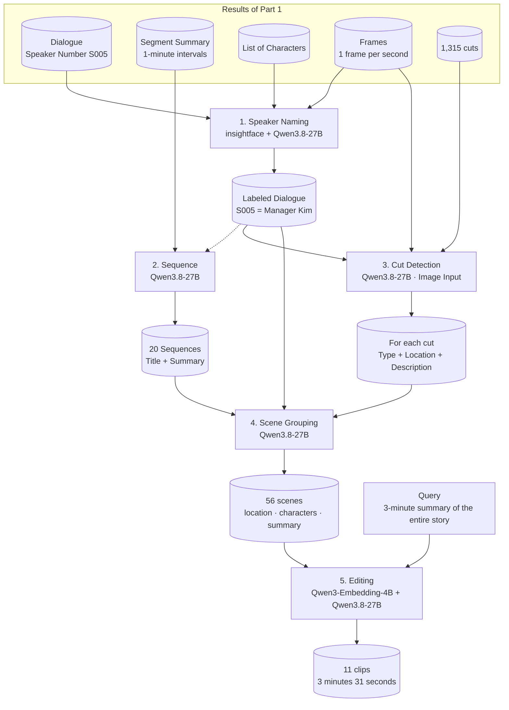

### Introduction

---

In Part 1, I broke down Episode 10 of the SBS drama “Manager Kim” into dialogue and scenes. This article covers the period leading up to the actual release of the short-form version.

<!--truncate-->

When Part 1 concluded, two issues remained.

- The audio side knew the name “Director Kim,” while the video side knew only the physical description: “a man in a suit wearing glasses.” **The two were not connected.**
- **I hadn’t decided how** to group the 1,315 cuts into scenes.

The second version (September 30, 2026–) resolved these two issues and added the feature “Create a short-form video with a single query.”

The changes can be summarized most simply as follows:

1. Assigning character names to speaker numbers (**New**)
2. Dividing episodes into event-based units — sequences (**New**)
3. Adding “location” to cut determinations (**Changed**)
4. Grouping cuts into scenes within a sequence (**Redesigned**)
5. Creating a clip list by selecting scenes via queries — Scheduling (**New**)

It runs from top to bottom based on the results from Part 1 (dialogue, segment summaries, cast list, frames).

```bash
# Steps to Follow After Part 1

python main.py 1027 # Assigning names to speakers
 ├ 1) Selecting Candidates (Qwen3.8-27B)
 ├ 1) Faces: Face Detection + Clustering (insightface buffalo_l)
 ├ 1) Split: Split the speaker into facial segments on the screen   (Rule)
 └ 1) Finalize the name for each match (Qwen3.8-27B, 3 rounds of voting)

POST /api/v1/analyze  {v_id:1027, stream_id:"VOD", force:true}
 ├    Cut Division (Same as Part 1)
 ├ 2) Summary of Dialogue in the Sequence → By Event (Qwen3.8-27B)
 ├ 3) Cut Judgment Screen Type + Location + Description    (Qwen3.8-27B, Image)
 └ 4) Cut to Group Scenes → Scene (Qwen3.8-27B)

POST /api/v1/compose {query: "3-minute summary of the entire story", budget_sec: 180}
 └ 5) Search for a scene → Select a song → Select a segment → Determine duration  (Qwen3-Embedding-4B, Qwen3.8-27B)
```

This is illustrated below.



These are the models used at each stage.

| Stage | Model | Input |
| --- | --- | --- |
| 1) Character Candidates · Name Matching | `Qwen3.8-27B-FP8` | Text |
| 1) Face Detection · Embedding | `insightface buffalo_l` | Image |
| 2) Sequence | `Qwen3.8-27B-FP8` | Text |
| 3) Cut Detection | `Qwen3.8-27B-FP8` | Image + Text |
| 4) Scene Grouping | `Qwen3.8-27B-FP8` | Text |
| 5) Editing — Scene Search | `Qwen3-Embedding-4B` | Text |
| 5) Editing — Song Selection and Segments | `Qwen3.8-27B-FP8` | Text |

As in Part 1, there is only one language model: `Qwen3.8-27B-FP8`. The two newly introduced models are face recognition (`buffalo_l`) and embedding (`Qwen3-Embedding-4B`).

The results after running all 10 episodes are as follows.

| Episode | Dialogue | Named Dialogue | Confirmed Character | Sequence | Scene |
| --- | --- | --- | --- | --- | --- |
| 01 | 370 lines | 213 lines | 6 people | 20 | 56 |
| 02 | 311 lines | 108 lines | 5 people | 13 | 61 |
| 03 | 307 lines | 123 lines | 4 characters | 15 sequences | 78 scenes |
| 04 | 230 lines | 11 lines | 1 character | 9 sequences | 59 scenes |
| 05 | 248 lines | 208 lines | 10 people | 9 items | 55 items |
| 06 | 280 lines | 218 lines | 8 people | 11 items | 60 items |
| 07 | 282 lines | 208 lines | 6 people | 10 items | 51 items |
| 08 | 297 lines | 121 lines | 4 people | 11 items | 50 items |
| 09 | 270 lines | 197 lines | 7 people | 14 | 71 |
| 10 | 333 lines | 239 lines | 10 people | 10 | 58 |

The 12,540 cuts were reduced to **599 scenes**. From 1,250 cuts per episode to 60 scenes—that’s one-twentieth.

---

##### 1. Assigning Speaker Names (insightface, Qwen3.8-27B)

- In Episode 1, lines are labeled with numbers like `S005`. We’ll replace these with “Manager Kim.”
- Voice alone isn’t enough, because speaker segmentation sometimes **groups different people under the same number**.
- Therefore, we also look at **the faces on screen**. This involves 4 steps.

```python
## poc-speaker-name/main.py

cands, text = candidates(video, dialogues, thinking)     # ① Candidate characters
fc = faces(config.MEDIA_DIR / str(v_id) / stream_id, ...)  # ② Face clusters
units, text = split(dialogues, fc) # ③ Split by speaker
result, text = match(dialogues, cands, units, thinking)   # ④ Finalize names
```

**1-1. Selecting Candidate Characters**

- Feed the **list** found on Wikipedia for Episode 1, along with the overall plot and dialogue, to an LLM to identify all “people who could appear in this episode.”

```python
## poc-speaker-name/lib/speaker/candidate.py

_SYSTEM = """\
You are a Korean drama script analyst. Base your answers solely on the provided materials, and do not invent names that do not appear in the materials.
- Include all the names in the list of characters.
- Include names and titles (such as "President," "Mom," "Older Brother," "Teacher," etc.) that are directly spoken or mentioned in the dialogue.
- Speaker labels (such as S000) are not names. Do not include them in the list of candidates.
- One entry per line; the format must be as follows.
  Name | Type | Source | Notes
  The type is either a real name or a title.
"""
```

- Results for Episode 1

```text
Director Kim | Real Name | List + Lines | Male Lead, Employee at a Small-to-Medium-Sized Savings Bank, Seq. 42, 48, 114
Sang-ah   | Real Name | List + Lines | Employee at a small-to-medium-sized savings bank, colleague of Manager Kim, seq. 55, 89, 90
Kim Min-ji | Real Name | List + Lines | Manager Kim's only daughter, seq. 16, 20, 21
Seong Han-su | Real Name | Profile | Taekwondo Gold Medalist, Martial Artist, Owner of a Local Taekwondo School
Joo Kang-chan | Real Name | List | Main Villain, CEO of Joo Hak Construction
```

- **Titles** like “Dad” or “Manager” are not considered names but are treated as clues and set aside separately.
  - Save them by attaching the nickname to the real name. Manager Kim = Dad, Manager, Uncle …

**1-2. Face Detection + Clustering**

- Detect faces in every frame at a rate of one frame per second, and group identical faces together.

```python
_MIN_SCORE, _MIN_SIDE = 0.6, 60 # Discard any points with a detection score below 0.6 or a side length less than 60px
_THRESHOLD, _MIN_CLUSTER = 0.6, 15    # Group clusters with a cosine distance of 0.6 or greater; discard clusters with fewer than 15 images

## poc-speaker-name/lib/speaker/face.py

_app = FaceAnalysis(name="buffalo_l", allowed_modules=["detection", "recognition"],
                    providers=["CUDAExecutionProvider", "CPUExecutionProvider"])

> def cluster(result: Faces) - None:
    emb = np.stack([f.emb for f in result.items])
    labels = AgglomerativeClustering(n_clusters=None, metric="cosine", linkage="average",
                                     distance_threshold=_THRESHOLD).fit(emb).labels_
    sizes = Counter(labels.tolist())
    rank = {c: i for i, (c, n) in enumerate(sizes.most_common()) if n >= _MIN_CLUSTER}
```

- Episode 1 Motion Log

```python
October 2, 2026, 3:59:57 PM [INFO] lib.speaker.face: faces: 4,015 images → 3,530 faces, 41s
October 2, 2026, 3:59:58 PM [INFO] lib.speaker.face: face: 397 clusters, 22 with 15 or more
```

- Of the 397 clusters, **only 22** are used. Faces appearing in fewer than 15 frames are considered extras.
- The face that appears most frequently is `F0`, followed by `F1`.

**1-3. Speaker Segmentation**

- For each speaker number, the “face that appeared most frequently on screen while speaking” is designated as the **representative face**.
- If a speaker is speaking but the representative face is not on screen—only other faces are present—that line is removed.

```text
S005 | Representative Face F0+F6 (Lines 59–74)
  279 → S005_F12 | Scenes 2846–2923 seconds F12+F20 | The chairman called for you, kid. Director Nam, what’s going on, guys? ...
  280 → S005_F12 | Scenes 2846–2923 seconds F12+F20 | Ora-mae is here. The schedule has changed. I'll get back to you.
  281 → S005_F12 | Scenes 2846–2923 seconds F12+F20 | Am I some kind of mutt that comes when I call and goes when I tell it to?
```

- `S005` appears alongside face `F0` in 59 out of 74 lines. `S005` = `F0`.
- However, in four lines of dialogue around the 47-minute mark, only `F12` and `F20` appear on screen.
  - The tone of voice is also different from the protagonist’s. It appears that the speaker segmentation has grouped **another person** as `S005`.

  - These lines are separated as `S005_F12`.

- Sections where no face is visible are left as is without further analysis.

**1-4. Name Confirmation**

- Character candidates, speaker units, and entire lines of dialogue are fed into an LLM, which assigns a name to each unit.

```python
## poc-speaker-name/lib/speaker/match.py

_SYSTEM = """\
- For names, use only those from the list of candidates that are real names.
- The basis must be one of the following: a response to being called by name (someone calls a name, and that person responds), self-introduction,
  Relationship titles. Do not make assumptions based solely on tone or content.
- If you're not sure, write "TBD" for the name. People who aren't on the list are also "TBD."
"""

def _vote(runs: list[dict[str, str]], labels: list[str]):
    need = len(runs) // 2 + 1 # At least 2 out of 3 times
    for s in labels:
        tally = Counter(r.get(s, "TBD") for r in runs)
        name, cnt = tally.most_common(1)[0]
        result[s] = name if name != "TBD" and cnt >= need else "TBD"
```

- Ask the same question **three times** and accept only the answers that receive a majority vote.
- Episode 1 Voting Results

```text
S002     | Kim Min-ji | Kim Min-ji 3
S003     | Ivory   | Ivory 3
S004     | Seong Han-su | Seong Han-su 3
S005     | Manager Kim | Manager Kim 3
S005_F12 | TBD   | TBD 3 # I don't know who wrote the line that was crossed out → Leave it blank
S006     | Park Jin-cheol | Park Jin-cheol 3
```

- Names are assigned to lines of dialogue.

```text
seq  Speaker   Name     Lines
16   S005   Manager Kim   Min-ji, wake up. Kim Min-ji.
41   S005   Manager Kim   Well, this is the corporate credit card statement. Last Wednesday, 95,000 won was charged for lunch...
45   S007 Let's just put it under "team dinner expenses," okay?
```

- Names are also assigned to faces. Information on “who is where” is recorded for each frame.

```text
Char     Face   Name     Position (x1, y1, x2, y2)
625    F0     Manager Kim   778,237,925,404
626    F0     Manager Kim   766,196,903,385
```

- **Conclusion**
  - In Episode 1, 213 out of 370 lines of dialogue were assigned names. The protagonist, Manager Kim, had the most with 70 lines.

  - If unsure, leave it blank. A blank space is better than an incorrect name.

- **Limitations**
  - There is significant variation from episode to episode. In Episode 10, 239 out of 333 lines had names, while in Episode 4, only 11 out of 230 lines did.

  - Episode 4 was the episode where the list of names found in Part 1 was particularly short.

---

##### 2. Sequences (Qwen3.8-27B)

- In Part 1, I got stuck trying to group 1,315 cuts directly into scenes.
- This time, **we first divide the episode into units based on major events.** These units are called sequences.
- We do not look at the footage. We divide the episode based solely on the **1-minute interval summaries** created in Part 1.

```text
# Sequence (t_sequence_drama)
seq: Sequence number (starting at 1, in chronological order)
start_sec   Start time (seconds) — Interval summary 1-minute window boundary
end_sec     End seconds
title Case Title (approximately 15 characters)
summary     1–2-sentence summary of the case (using character names)
```

- The boundaries are **in 1-minute increments**. Since the segment summaries are based on 1-minute windows, I use those boundaries as-is. Precise boundaries will be determined in the next step (scenes).
- Results for Episode 1 — 20 segments

```text
Start, End, Title, Summary
00:04:00   00:10:00   Min-ji’s Morning Routine and the Walk to School Manager Kim wakes up his daughter Min-ji and urges her to eat breakfast and get ready for school, ...
00:10:00   00:13:00   Allegations Regarding Corporate Credit Card Use and Gift Plans: Manager Kim raises suspicions about the deputy branch manager’s corporate credit card transactions, and ...
00:13:00   00:16:00   Joo Ae-ri Shows Off Her Bag at School and Faces Conflict   Joo Ae-ri attracts her friends' attention by showing off her limited-edition bag, but...
00:16:00   00:20:00   Visiting the Department Store and Persuading Someone to Buy a T-Shirt Manager Kim and Sang-ah visit the department store and...
00:53:00   00:56:00   Min-ji's Anger and Declaration to Run Away From Home Min-ji, enraged by her father's groveling apology, declares she is running away from home, and ...
```

- The 67 minutes are organized into 20 events. Each event lasts 2–7 minutes.
- **Limitations**
  - Unnamed speakers are identified by their numbers in the summary.

  - Example: “S007 threatens S005 to take off their clothes, and S013 reveals that S005 is a double agent from North Korea.”

##### 3. Cut Classification — Location Added (Qwen3.8-27B)

- The cut analysis for Episode 1 used the **type + description** format. **Location** has now been added to this.
- The format remains the same: the first frame of the cut and the dialogue for that segment.
- Results for Episode 1

```text
Start Type Location Description
00:10:19.5  ACTION    Samsung Savings Bank Office   A man in a suit wearing glasses walks around the office holding some documents...
00:10:22.7  DIALOGUE  In a savings bank office, a man wearing glasses stands at a desk, holding up some documents and saying...
00:10:25.5  DIALOGUE  A man wearing glasses in a savings bank office stands in front of his desk... and speaks while pointing out the corporate credit card statements.
00:10:36.7  CLOSE-UP   A man in a suit wearing glasses inside a savings bank office... looks startled.
```

- Location is **a tool for dividing scenes**.
  - When the location changes, the scene changes. Assigning locations to 1,315 cuts makes it clear “where to cut.”

- Locations that appeared frequently in Episode 1

| Location | Number of Cuts |
| --- | --- |
| School Classroom | 111 |
| Savings Bank Office | 51 |
| Parking Lot | 46 |
| Restaurant (during company dinner) | 42 |
| School hallway | 38 |
| Sauna | 35 |

- The number of scene types has also increased. In addition to the 7 from the first installment, `RECAP` (Previous Episode) and `PREVIEW` (Next Episode) have been added.
- **Limitations**
  - The same location is labeled differently in each panel. “Samsung Savings Bank Office” and “Savings Bank Office” are used interchangeably.

  - This is because the cuts are viewed individually. Labels shouldn’t be split based on whether the text is the same; they should be grouped by meaning.

  - Out of 1,315 cuts, 34 have no location listed (titles, black screens, etc.).

##### 4. Grouping Scenes (Qwen3.8-27B)

- In Part 1, we couldn’t decide whether to “break down the 1,315 cut lines into small pieces or group them into larger units.”
- This time, the **sequence becomes the unit of division**.
  - We provide the LLM with the cut descriptions, locations, and dialogue within a single sequence (2–7 minutes), and divide the scenes within that sequence.

  - Since the cut points align with plot boundaries, the context remains intact in each segment.

```text
# Scene (t_scene_drama)
scene_seq   Scene number (starting from 1, in chronological order)
start_sec   Seconds into the scene (= seconds into the opening shot)
end_sec     Seconds until the end of the scene (= end of the last shot)
scene_type  MAIN (Main Story), FLASHBACK (Flashback), RECAP (Recap), PREVIEW (Preview), AD (Commercial), CREDIT (Credits)
place
speakers    List of speaker IDs (dialogue tally)
Character Descriptions (LLM Inference)
summary     Scene Summary
```

- The start and end of each scene are aligned with **cut boundaries**. While sequences were roughly divided into 1-minute units, scenes are aligned with cuts in 0.1-second increments.
- Results for Episode 1 — 56 scenes (51 in the main story)

```text
00:10:02 – 00:13:00  MAIN  Samsung Savings Bank Office
  Speakers: S004, S005, S008, S007, S003
  Characters: Man wearing glasses (Manager Kim), Man wearing glasses (Assistant Branch Manager), Woman in a gray top (Sang-ah)
  Summary: Manager Kim pointed out discrepancies in the assistant branch manager’s corporate card statements to prompt him to expense the dinner costs, and then, on his daughter Min-ji’s birthday...
        While searching for self-defense items to give as a gift, I receive an invitation from Sa-ah to go to the department store with her.

00:13:06 – 00:14:31  MAIN  School Classroom
  Speakers: S002, S003, S007, S017, S016, S010
  Characters: Female student in a school uniform (Kim Min-ji), female student in a school uniform (Kang Hye-ri), blonde female student with a pearl hairband (Joo Ae-ri), ...
  Summary: Kim Min-ji has a conflict with Kang Hye-ri over a gym uniform, and Ju Ae-ri shows off her limited-edition bag to her friends...
        Amid the taunts, Kim Min-ji feels left out.

00:14:31 ~ 00:15:54  MAIN  School Girls' Restroom
  Summary: In the restroom, Joo Ae-ri teases and bullies Kim Min-ji by pointing out the smell of cigarette smoke, and Kang Hye-ri tries to stop her, but...
        Joo Ae-ri ignores me.
```

- The bank office scene cited as an example in Episode 1 was grouped into **a single scene (approx. 3 minutes)**. There are dozens of cuts within it.
- The labeling, which varied from cut to cut—such as “Samsung Savings Bank Office” and “Savings Bank Office”—was standardized into a single form.
- Character descriptions follow the format **"Man with glasses (Manager Kim)"**.
  - This is where the visual appearance on screen and the name associated with the voice align. This resolves the first issue identified in Episode 1.

- Scene lengths average around 1 minute. Ranging from 48 seconds to 81 seconds depending on the episode.
- **Limitations**
  - Character descriptions are based on LLM inferences, so some are incorrect. In one scene in Episode 1, there is a “man in a suit (Sang-ah),” but Sang-ah is a female colleague.

  - There are also very short scenes lasting only a few seconds. (Shortest in Episode 1: 5 seconds)

- Record of replaying Episode 1 from the beginning (October 2, 2026)

| Stage | Time | Duration |
| --- | --- | --- |
| Cut Division | 16:04:43 ~ 16:07:03 | 2 minutes 20 seconds |
| Sequence | ~ 16:07:22 | approx. 20 seconds |
| Cut Detection | ~ 16:11:37 | approx. 4 minutes 15 seconds |
| Scene Grouping | ~ 16:12:02 | approx. 25 seconds |
| Complete | 16:12:35 | Total: approx. 8 minutes |

- Most of the time is spent on cut determination (1,315 calls). Sequences and scenes only handle text, so they finish quickly.
- The order is **Sequence → Cut Judgment**. Since sequences only require a summary of the dialogue, they do not wait for the cut judgment.

---

That concludes the preparation of the materials. Now, we’ll use these materials to create short-form content.

##### 5. Editing (Qwen3-Embedding-4B, Qwen3.8-27B)

- Given a **single line of query** and a **target length**, it selects segments from the scenes to create a list of clips.

```bash
POST /api/v1/compose
{
  "query": "3-minute summary of the entire story",
  "budget_sec": 180
}
```

- Processing Order

```text
① Read Scenes: Retrieves the list of scenes for this episode
② Interpret the question: Read who, what, and how many minutes it refers to.
③ Finds scenes similar to the scene search query (Qwen3-Embedding-4B)
④ Select a scene to use from the list of song candidates (Qwen3.8-27B)
⑤ Determine the section to be used within the start and end point scenes (Qwen3.8-27B)
⑥ Merge Overlapping Clips    Merges overlapping clips into a single clip
⑦ Adjusting the Amount    Scoop out the amount needed to reach the target length
```

- **Do not use entire scenes.**
  - Scenes average 1 minute in length. You cannot fit a 3-minute summary into just 3 scenes.

  - Only **10–25-second segments** are extracted from each scene. Sometimes, multiple segments are taken from a single scene.

- Episode 1 “3-Minute Summary of the Entire Story” Results — 11 clips, 3 minutes 31 seconds

```text
#   Segment Length  Location  Scene Summary
1   6:43 PM – 7:04 PM   21 seconds  Department store clothing section    When Manager Kim refuses to buy a 500,000-won T-shirt, Sa-ah... persuades him, and he eventually decides to buy it.
3   33:50–34:13   23 seconds  In front of the restaurant where the company dinner is taking place   After witnessing the violent incident inside the restaurant, Seong Han-su tells Manager Kim...
5   42:12–42:29   17 seconds  At the Samsung Savings Bank office, Manager Kim receives a call from Hye-ri’s father saying that Min-ji assaulted Hye-ri, and he rushes to the scene.
6   43:28–43:39   11 seconds  (same scene)
7   43:48–44:01   13 seconds  (same scene)
9   50:27–50:47   20 seconds  The school’s faculty office... Director Kim gets down on his knees to apologize and accepts the transfer.
10  54:32–54:54   22 seconds  Parking lot in front of the school building  Manager Kim bows his head to Ju Kang-chan to apologize for his daughter’s school bullying incident, and ...
11  64:25–64:49   24 seconds  An alley in front of a ruined building. Manager Kim discovers a pool of blood and Min-ji’s headband in the ruined alley, and...
```

- Department store → School bullying call → Apology in the faculty office → Parking lot → Disappearance. These were selected **in the order of the Episode 1 plot**.
- Clips 5, 6, and 7 were taken from the same scene (bank office).
- The results are displayed in two tables.

```text
# Composition (t_compose)
comp_id: Schedule ID
query: Original user query
budget_sec    Target duration (seconds) — Leave blank to skip trimming
duration_sec  Total length of final clips (seconds)
clip_cnt: Final number of clips

# Clip (t_compose_clip)
clip_seq Playback Order
v_id: The episode from which this clip was taken
scene_seq     Which scene is this from?
start_sec     Seconds from the start of the clip
end_sec: Seconds to the end of the clip
```

- Results from modifying the query

| Query | Goal | Result | Clips |
| --- | --- | --- | --- |
| 10-minute summary of key plot points only | 600 seconds | 455 seconds | 6 clips |
| 3-minute summary of key plot points only | 180 seconds | 191 seconds | 2 clips |
| 3-minute summary of the entire story | 180 seconds | 211 seconds | 11 clips |
| Summary of the entire drama plot (10 episodes) | None | 7,205 seconds | 251 clips |

- Even though they’re both “3-minute summaries,” the results vary significantly depending on how they’re defined.
  - “Key points only” yielded 2 long clips, while “Full” yielded 11 short clips.

- **Multiple episodes can be grouped together at once.**
  - The last line combines all 10 episodes. There are 17–37 clips per episode, totaling 120 minutes.

  - To achieve this, a separate table (`t_compose_video`) was created to attach multiple episodes to a single schedule entry.

- Each scheduling entry took 46 seconds to 4 minutes to complete.
- **Limitations**
  - The target duration cannot be met exactly. For an 180-second target, the results were 191 seconds and 211 seconds. For a 600-second target, the result was 455 seconds.

  - Without a target, the summaries tend to run long. If a summary of 10 episodes takes 2 hours, it’s hard to call it a “summary.”

---

#### Conclusion

For the 10 episodes of “Manager Kim,” I assigned character names to 1,646 lines of dialogue, created 122 sequences and 599 scenes, and completed the process of generating a clip list with a single query.

The two issues left over from Episode 1 were resolved as follows.

- Linking names to physical appearances → Speakers were grouped by facial features and then consolidated into “man wearing glasses (Director Kim)” based on character descriptions in the scenes.
- Method for grouping scenes → First divided them into sequences, then grouped them within those sequences based on location.

Some issues were also identified.

- The rate at which names are assigned varies significantly from episode to episode. (11 lines out of 230 in Episode 4)
- Incorrect information is mixed in with character descriptions and summaries.
- The edited length does not align with the target.

These three issues remain as tasks for the next phase.

Reference links)

- [https://github.com/deepinsight/insightface](https://github.com/deepinsight/insightface)
- [https://scikit-learn.org/stable/modules/generated/sklearn.cluster.AgglomerativeClustering.html](https://scikit-learn.org/stable/modules/generated/sklearn.cluster.AgglomerativeClustering.html)
- [https://docs.vllm.ai/](https://docs.vllm.ai/)

*This article presents the results of research conducted with support from the Ministry of Science and ICT and the National IT Industry Promotion Agency’s “2026 Open-Source AI and Software Development and Utilization Support Project.”*

