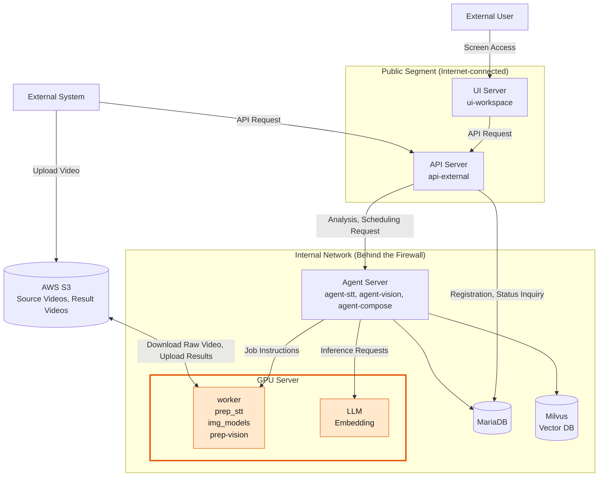
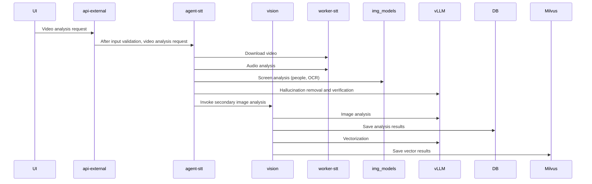
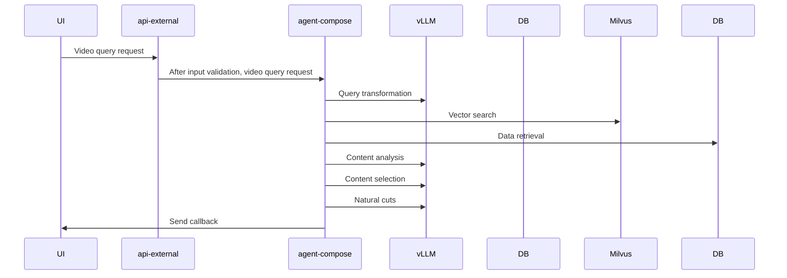

## 1. Overview

SceneMaker is a service that takes a single broadcast video, analyzes and indexes it using open-source multimodal AI, and compiles highlight segments based on natural language queries. The entire system is divided into two workflows.

| Workflow | Start | End | Task |
| --- | --- | --- | --- |
| **Input (Analysis) Process** | Video Upload (api-external) | Indexing Complete (MariaDB + Milvus) | Audio → Subtitles → Frame Detection → Scene Analysis → Embedding Index |
| **Query (Curation) Process** | Curation Request (api-external) | List of Clip Segments (Callback) | Query Interpretation → Evidence Search → Scene Selection → Boundary Determination → Duration Adjustment |

There is one design principle that distinguishes these two workflows: **The orchestrator does not perform GPU computations.** `agent-*` determines what to process and in what order, while the actual inference is performed by remote GPU servers (workers and vLLM). Components are loosely connected via HTTP, a shared database, and `status_code`. Among the four major services, the current implementation corresponds to **Highlights (Highlight Curation)**.

---

## 2. Service Flow

### 2.1 Video Analysis

### 2.2 Video Query

---

## **3. Components**

| Layer | Component | Type | Role |
| --- | --- | --- | --- |
| Entry | **api-external** | FastAPI | External public API gateway. Group and video registration are handled directly in the DB; analysis and scheduling are proxied to the backend as-is; status is retrieved from the DB |
| Orchestrator | **agent-stt** | FastAPI | First-stage processing (subtitles). Extraction → STT → Correction → Hallucination Filter → Summary, Frame Detection, Speaker Name, Storage, Trigger Next Step |
| Orchestrator | **agent-stt** | FastAPI | First-stage processing (subtitling). Scene segmentation → Reading on-screen text → Scene classification and summarization → Playback and scene composition → Milvus indexing |
| Orchestrator | **agent-compose** | FastAPI + LangGraph | Query processing (editing). Query interpretation → Evidence retrieval → Scene selection → Boundary definition → Duration |
| Worker | **worker-prep_stt** | FastAPI (GPU) | S3 download, ffmpeg audio and 1 fps frame extraction, primary transcription (pyannote + Qwen3-ASR), secondary transcription (faster-whisper) |
| Worker | **worker-img_models** | FastAPI (GPU) | Frame classification and detection. Baseball scoreboard (SigLIP2 + RF-DETR), drama face clustering |
| Worker | **worker-prep-vision** | FastAPI (CPU + VLM calls) | PySceneDetect scene cuts; read and transcribe text from scoreboard crops using VLM |
| Worker | **worker-render** | FastAPI (GPU) | Segment list → Insert bumpers → ffmpeg cut and concatenate → MP4 → Upload to S3 |
| Inference | **vLLM** | OpenAI-compatible server | Text LLM (Qwen, `/v1/chat/completions`), VLM (Qwen3-VL), Embeddings (`/v1/embeddings`) |
| Storage | **MariaDB** | RDB | Registration, status, subtitles, frames, scenes, and scheduling. Shared by all components |
| Storage | **Milvus** | Vector DB | Scene text (shot / stt / etc.) embeddings. Indexing by agent-vision, searching by agent-compose |
| Storage | **S3 / NVMe** | File | Raw video (S3), extraction outputs, crops, and rendering results (worker local → S3) |
| UI | **ui-workspace** | Next.js | Upload (S3 presigned + t_video registration) · Analysis results viewing console |

Actual host and IP addresses are specified only in the `.env` section of each component.

---

## **4. Data**

#### 4.1 MariaDB

| Group | Content |
| --- | --- |
| Registration | Category, Group (Callback), Video (Episode·`stream_yn` ·`summary_stt` ), Segment (`file_path` ·`status_code` ·`idx_last` ), Code Phrases |
| Subtitles | Dialogue that has undergone proofreading and filtering (timestamp, speaker, language, name), segment and full summaries |
| Frames (Baseball) | Frame-by-frame classification, scoreboard, 7 items, fixed boxes per video segment |
| Speakers (Drama) | Face cluster names, face vector bank by series |
| Scene (Baseball) | Scene cuts (+classification·summary), scoreboard timeline, plays by pitch, scenes for programming (inning·team·score·tag·label·end candidate) |
| Scheduling | Request·Status·Duration, Target Segment, Resulting Clip |
| Auxiliary | Team Nicknames |

The reprocessing rule is the same for any stage. **Delete the results of that segment and the one following it, then recreate them.**

#### 4.2 Two Timelines

Since baseball footage is imported in inning segments, time exists on two axes: time within a segment (`idx_stream_sec`, `*_stream_time`) and time relative to the entire video (`idx_sec`, `*_time`). The offset on the overall timeline is the sum of the `idx_last + 1` values from the preceding segments. The frame/scene table contains both timelines, and the scheduling results (callbacks) are output based on the **segment timeline**. Rendering is also based on the segment files.

#### 4.3 Milvus

| Item | Value |
| --- | --- |
| Collection | Baseball `sm_sport_baseball`, Drama `sm_drama` |
| Row Type (`kind`) | `shot` (Scene Summary) · `stt` (Dialogue) · `etc` (Scoreboard/ETC Text) |
| Scalar Field | `v_id, stream_id, start_sec, end_sec, scene_stream_seq, scene_seq, shot_type, labels, board_tags, inning, home_team, away_team, score, score_delta, text` |
| Vector | 2560-dimensional (Qwen3-Embedding family, vLLM `/v1/embeddings` ) |
| Write / Read | agent-vision PUBLISH (delete-insert) / agent-compose retrieve_evidence (filter + top_k) |

#### 4.4 Files

| Location | Path Rules | Creation Location |
| --- | --- | --- |
| S3 Original | `video_file.file_path`  Object Key | External Upload |
| Worker Local | `MEDIA_DIR/{v_id}/{stream_id}/{stream_id}.mp4`  · `{stream_id}_audio.wav`  · `00000.jpg …` (1 fps) | worker-prep_stt |
| Worker Local | `…/{stream_id}/img_models/{항목}/{idx}.jpg`  (digital signboard crop) | worker-img_models |
| Render | `{VOD_DIR}/{v_id}/result/{v_id}_{c_id}.mp4`  + `.json`  → S3 `result/` | worker-render |

Workers **do not receive files** but **redirect paths** to `v_id/stream_id`. Therefore, prep_stt, img_models, prep-vision, and agent-vision must reside on a host that accesses the same storage (NVMe).

---

## 5. **Status Codes**

All status information is represented by `status_code` numbers, while the descriptions are stored in the `t_code` table. The row number corresponds to the owning component.

| Row | Owner | Table | Key Values |
| No. | Owner | Table | Key Values |
| --- | --- | --- | --- |
| 1000 | UI (Upload) | `t_video` | 1001 Upload |
| 2000 | agent-stt | `t_video_file` | 2001 Received · 2010/2011 Extracting/Complete · 2020 Search · 2030 Dialogue Extraction · 2040 Verification · 2050/2060 Correction · 2070 Hallucination · 2080 Summary · 2085 Speaker · **2000 Complete** |
| 3000 | agent-vision | `t_video_file` | 3010 PREP · 3020 BOARD · 3060 VISION · 3030 PLAY · 3040 SCENE · 3050 PUBLISH · **3000 Complete**  · 3900 Failure · 3901 Not Supported |
| 4000 | agent-compose | `t_compose` | 4020 PLAN · 4030 CUT · 4040 VERIFY · **4000 Complete**  · 4001 Empty Schedule · 4900 Error · 4050/4950 Render (Render Ownership) |

There is a pattern for agent-stt failure codes. **Process code + 900 = failure code for that stage**, and the last digit indicates the cause (+0 Other / +1 Connection Failure / +2 Timeout / +3 Stage-specific). For example, if a connection to the transcription server fails while extracting dialogue (2030), the code is 2931. Code values are stored in the source and not read from the database. This is because they must be recorded even when the database is down (2996).

---

## 6. Design Principles

1. **The orchestrator does not perform GPU computations.**  Inference is called via OpenAI-compatible methods (`/v1/chat/completions` ·`/v1/embeddings`) or the worker’s own HTTP endpoint; even if the remote service is swapped out, as long as the specifications remain the same, only the address in `.env` needs to be updated. If the specification changes, only `lib/client/*` is modified.
2. **Respond immediately upon receipt; processing occurs in the background.**  Progress is reported via `status_code`, and completion is reported via a callback.
3. **There is only one criterion for “completion.”**  The status code is logged in one place, and saving is done in a single transaction. We do not save partially.
4. **A single category table determines the workflow.**  The step order is fixed; the table only specifies which steps to enable or disable and the required materials. A new category is represented by a single row in the table.
5. **The failure policy is determined by the nature of the step.**  Auxiliary steps (roster search, secondary transcription, Milvus indexing) are swallowed, while core steps are reported as a total failure. The failure code is the progress code + 900.
6. **Workers keep the model resident and run as a single process.**  `uvicorn --workers`  is not used. Serialize using a GPU lock, and even in case of failure, return an HTTP 200 response with the `Result` /`status`  number. Simply append the rejection reason number to the end.
7. **When reprocessing, clear everything up to that point.**  `forced_yn` /`force`  clears the results of that segment and the segments that follow, then regenerates them.
8. **LLM output is verified by the code.**  Provide options in the prompt and discard values outside the vocabulary. When correcting subtitles, change only the text; if it gets cut off, revert to the original text.
9. **Operational coordinates are** `.env`  **only.**  Do not include IP addresses or credentials in the code or documentation.

---

